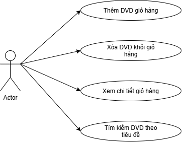

# Sơ đồ Use Case – Hệ thống AIMS-mini

## 1. Tác nhân (Actor)
- **Customer (Khách hàng):** Người dùng tương tác với hệ thống cửa hàng AIMS để tìm kiếm DVD và quản lý giỏ hàng mua sắm.

## 2. Danh sách Use Case
1. **Thêm DVD vào giỏ hàng (Add DVD to Cart):** Khách hàng chọn DVD và thêm vào giỏ hàng (giới hạn tối đa 20 đĩa).
2. **Xóa DVD khỏi giỏ hàng (Remove DVD from Cart):** Khách hàng loại bỏ một đĩa DVD ra khỏi giỏ.
3. **Xem chi tiết giỏ hàng (View / Print Cart):** Hiển thị danh sách các đĩa đã đặt và tổng giá tiền.
4. **Tìm kiếm DVD theo tiêu đề (Search DVD by Title):** Tìm kiếm các đĩa trong cửa hàng khớp với từ khóa tiêu đề.

## 3. Sơ đồ Use Case

